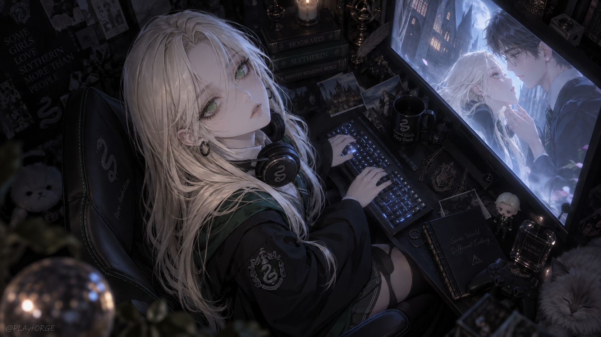
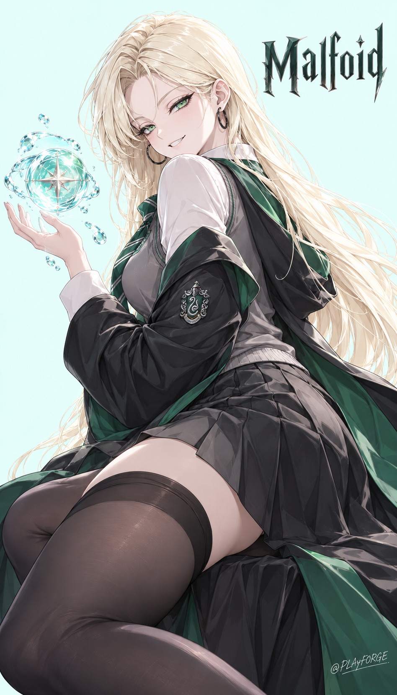
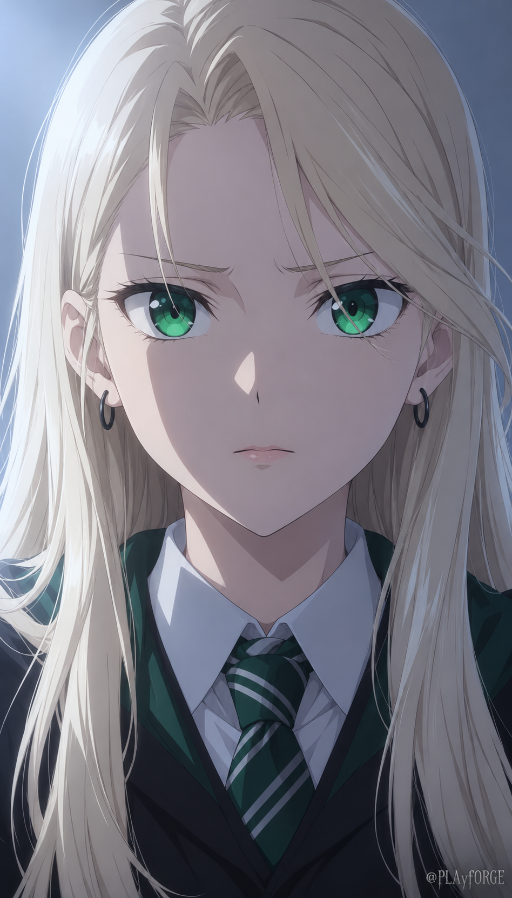
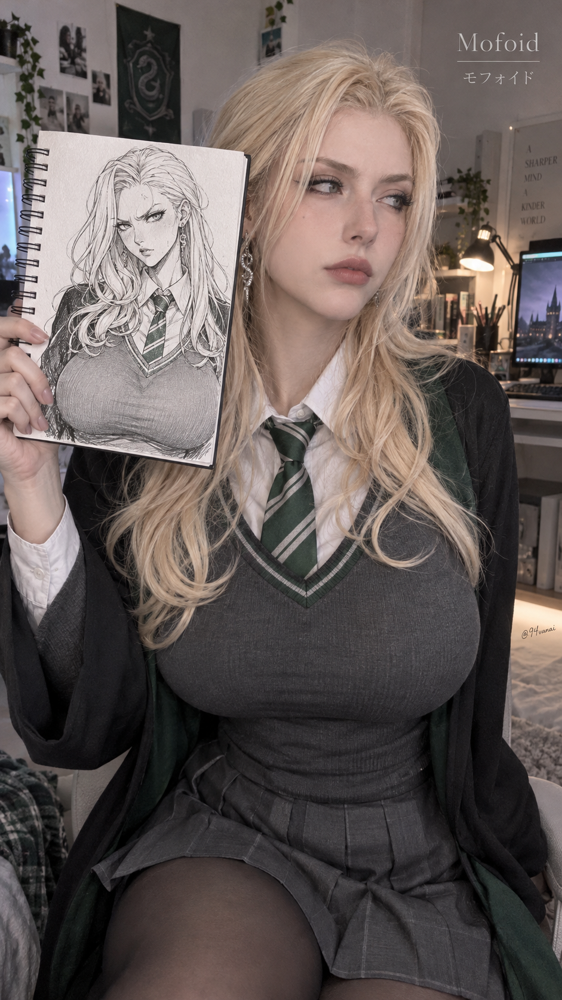

# Malfoid · Gallery

铂金长发、碧绿眼眸与绿银服饰，贯穿暗夜叙事、明亮魔法、细腻表情和真人摄影四种画面。

Platinum hair, emerald eyes, and green-and-silver clothing connect four scenes: a midnight gaming room, luminous magic, an intimate expression study, and a photographic cosplay portrait.

プラチナブロンドの髪、エメラルドの瞳、緑と銀の衣装を軸に、深夜の部屋、明るい魔法、繊細な表情、コスプレ写真を展開します。

백금발, 에메랄드빛 눈, 녹색과 은색 의상을 중심으로 심야의 방, 밝은 마법, 섬세한 표정, 코스프레 사진을 선보입니다.

| 提示词语言 · Prompt language | 完整示例 · Complete examples |
| --- | --- |
| 中文 | [中文提示词](../references/languages/zh-CN.md#完整示例) |
| English | [English prompts](../references/languages/en.md#complete-examples) |
| 日本語 | [日本語プロンプト](../references/languages/ja.md) |
| 한국어 | [한국어 프롬프트](../references/languages/ko.md) |

[English prompt JSON](prompts.json)

## midnight-gaming-room · 暗夜电竞房 · 深夜のゲーミングルーム · 심야 게이밍 룸

俯视斜构图、回眸、挂颈耳机、蓝色键盘和屏幕冷光。收藏品、烛火与画中画组成高密度的黑绿空间，人物的眼睛和铂金发丝保持清晰。

High diagonal view, an upward glance, headphones, blue screen light, and a richly layered collector's room. **1672 × 941 PNG · 16:9**

## aqua-magic-poster · 薄荷魔法海报 · ミント色の魔法ポスター · 민트빛 마법 포스터

薄荷色留白、侧身回眸、飘动长发和绿衬长袍。透明水球、银色星芒与悬浮水滴围绕掌心，明亮高光与深色衣料形成鲜明层次。

Mint negative space, a confident over-the-shoulder pose, flowing hair, and a transparent aqua sphere with a silver star. **948 × 1659 PNG · 4:7**

## emerald-closeup · 冷光表情特写 · 冷たい光とエメラルドの瞳 · 차가운 빛과 에메랄드 눈

正面胸上特写、微蹙眉心与轻启嘴唇，以碧绿眼睛为视觉中心。左上冷光、干净赛璐璐阴影和蓝灰背景突出克制而敏感的表情。

A centered anime close-up with luminous emerald irises, subtly tense brows, cool side light, and clean cel shadows. **948 × 1659 PNG · 4:7**

## cosplay-sketchbook · 真人手绘本 · コスプレとスケッチブック · 코스프레와 스케치북

真人摄影与纸上漫画同框：人物手持线圈画本，视线投向画外。铂金长发、绿银领带与炭灰针织背心连接两种表现方式，窗光、暖台灯和生活化陈设带来真实质感。

A photographic cosplay portrait beside a hand-held manga sketchbook, with tangible paper, knit fabric, soft window light, and a warm desk lamp. **941 × 1672 PNG · 9:16**

