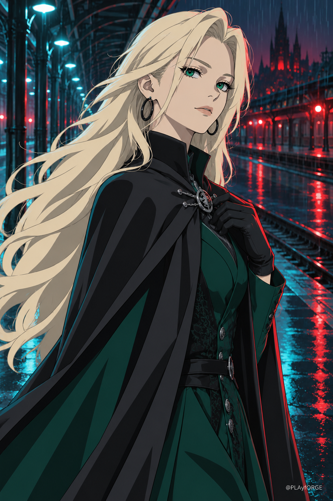
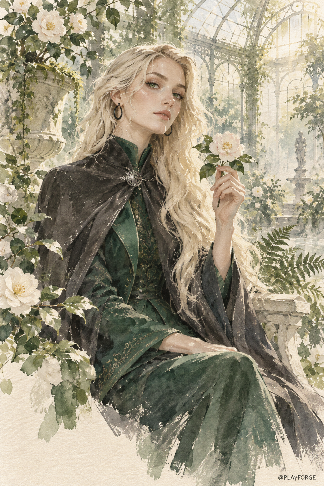
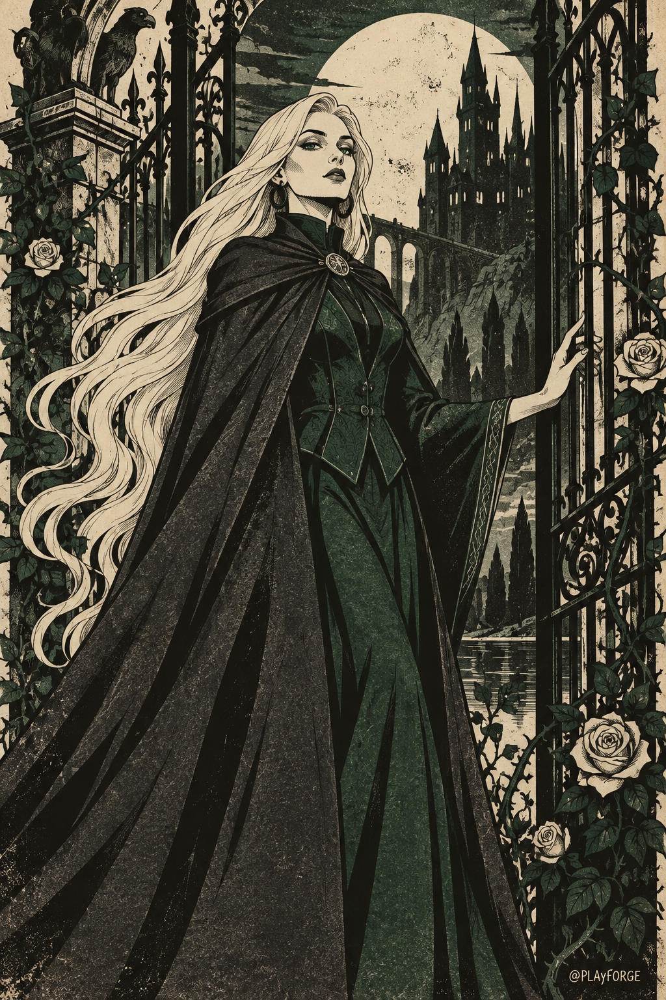
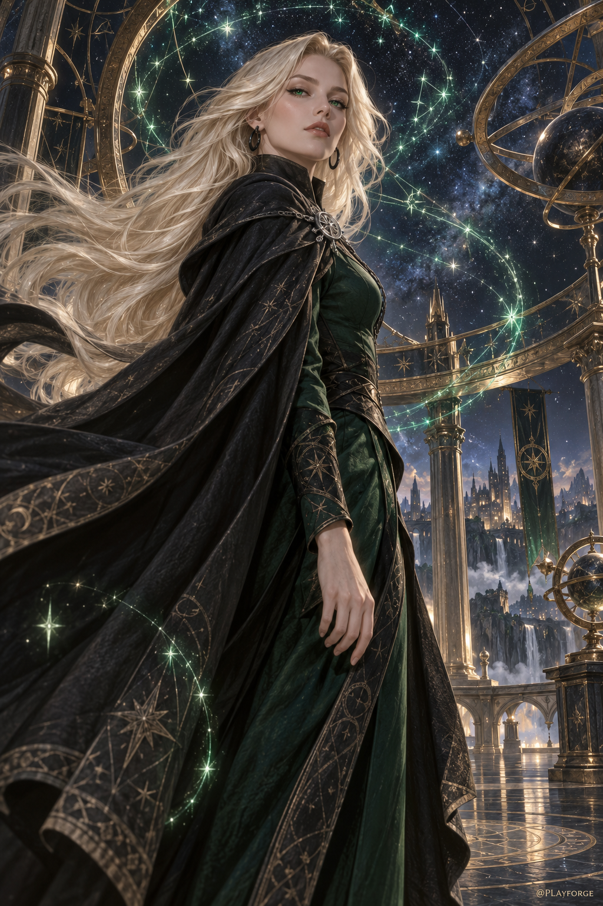

# Malfoid · Four Styles

四张独立插画，共用铂金长发、碧绿眼眸、黑色环形耳环与黑绿服装，以不同媒介呈现人物。

Four standalone illustrations explore cel animation, watercolor, gothic print, and celestial fantasy painting. Each is a 1024 × 1536 PNG created with the built-in ImageGen tool.

| 提示词语言 · Prompt language | 完整示例 · Complete examples |
| --- | --- |
| 中文 | [四种风格提示词](../references/languages/zh-CN.md) |
| English | [Four style prompts](../references/languages/en.md) |
| 日本語 | [4種類の作例プロンプト](../references/languages/ja.md) |
| 한국어 | [4가지 스타일 프롬프트](../references/languages/ko.md) |

[独立样图提示词 · Standalone example prompts](prompts.json)

## anime-rain · 雨夜动画 · 雨夜のアニメ · 빗밤 애니메이션

锐利线条、成组发束、赛璐璐阴影与青红霓虹，在雨夜车站交汇。

## watercolor-garden · 水彩花园 · 水彩の温室 · 수채화 온실

象牙白纸感、湿画法与不透明水粉，配合晨光、山茶花与鼠尾草绿。

## gothic-print · 哥特版画 · ゴシック版画 · 고딕 판화

炭黑、象牙白与墨绿构成套色版画，月亮、铁门和蔷薇形成装饰框景。

## celestial-poster · 星空海报 · 星空ポスター · 별빛 포스터

深靛蓝星空、古金色星盘与翡翠绿星轨，构成华丽的幻想画面。

